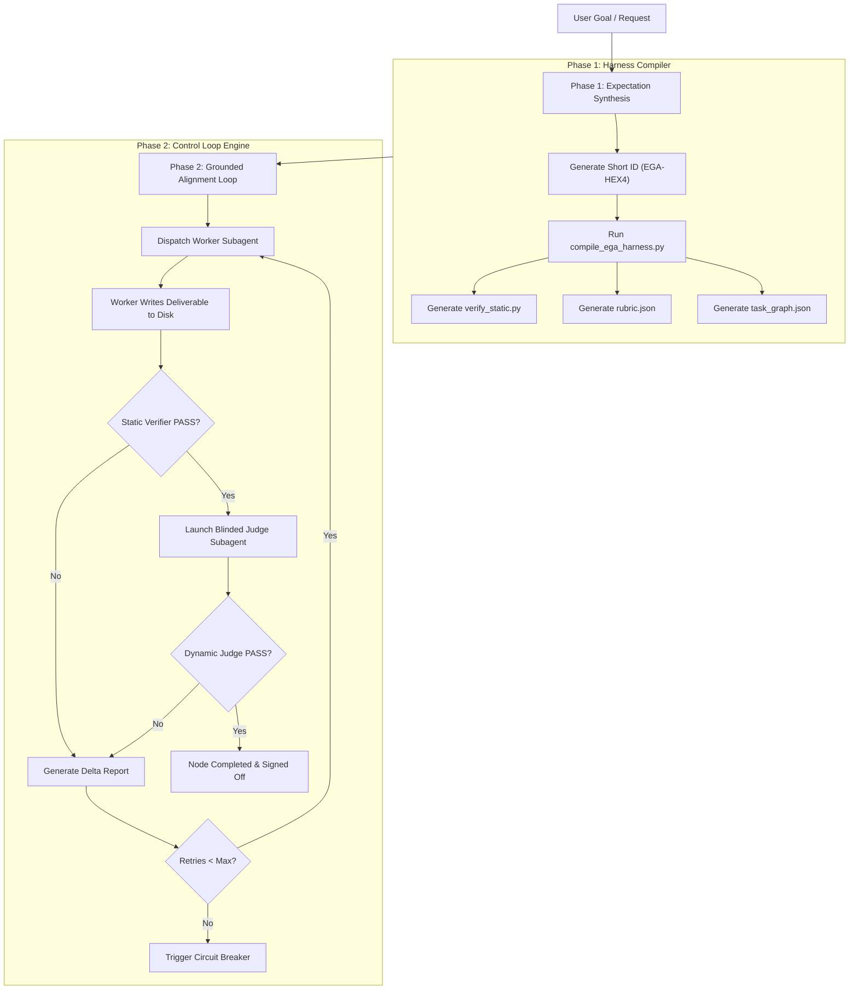

# Expectation-Grounded Alignment (EGA) Harness Custom Skill

You are now operating under the **Expectation-Grounded Alignment (EGA)** Engine skill (invoked via `/harness` or `/ega`).

Your objective is to enforce the **Expectation-Grounded Alignment (EGA)** paradigm: **synthesize verifiable expectations (static check scripts + blinded dynamic judge rubrics) BEFORE writing code or text**, then execute work against those contracts in an iterative dual-verification control loop until all expectation gates pass with zero defects.

---

## 🛑 Core Operating Directives & Philosophy

1. **Expectation Synthesis First**: Never write implementation code, documents, or analyses directly. Always generate the Short ID (`EGA-<HEX4>`), the deterministic static verifier script (`verify_static.py`), the dynamic judge rubric (`rubric.json`), and the micro-chunked task DAG (`task_graph.json`) first under `.gemini/harness/<SHORT_ID>/`.
2. **Intent-First Specification**: The task directives (`tasks/task_XX_spec.md`) specify *what* needs to be accomplished, target artifact paths, and expectation contracts. The worker subagent maintains complete autonomy over *how* to implement the solution.
3. **Dual-Verification Gate Enforcement**: Every deliverable MUST pass both:
   - **Static Layer**: Deterministic Python/Node verifier script checking syntax, compilation, word bounds, section headers, link health, and placeholders.
   - **Dynamic Layer (Blinded LLM-as-a-Judge)**: A fresh subagent launched with **ZERO past conversation memory or execution history pollution**, evaluating the deliverable against `rubric.json` purely as an author-blind submission.
4. **Iterative Delta Feedback Loop**: If either gate fails, parse the failure output into a concise **Delta Report** (`<node_id>_delta_report.md`) and feed it back to the worker subagent for pinpointed remediation (capped at `max_retries=3`).
5. **Fixed-Model Calibration**: Apply context slicing (passing only the immediate sub-goal spec and rubric) and disk scratchpad persistence (`.gemini/harness/<SHORT_ID>/scratchpad.json`) to maximize reliability regardless of the underlying model assignment.

---

## 🧭 Operational Workflow (Phase 1 vs. Phase 2)

### Phase 1: Expectation Synthesis
1. Execute `python3 /Users/ksprashanth/code/github/skills-expectation-harness/skills/expectation-harness/scripts/compile_ega_harness.py "<USER_GOAL>"` to initialize `.gemini/harness/<SHORT_ID>/`.
2. Inspect `verify_static.py` and customize deterministic checks for the specific domain problem statement (coding, research, documentation, strategy). Refer to **[Static Verifiers Guide](file:///Users/ksprashanth/code/github/skills-expectation-harness/skills/expectation-harness/references/static_verifiers.md)**.
3. Inspect `rubric.json` and customize qualitative evaluation criteria and thresholds for the Blinded Judge. Refer to **[Dynamic Judges Guide](file:///Users/ksprashanth/code/github/skills-expectation-harness/skills/expectation-harness/references/dynamic_judges.md)**.
4. If the goal is large, break it into micro-chunked atomic nodes in `task_graph.json`. Refer to **[Model Calibration Guide](file:///Users/ksprashanth/code/github/skills-expectation-harness/skills/expectation-harness/references/model_calibration.md)**.

### Phase 2: Grounded Alignment Execution & Control Loop
1. Dispatch the **Worker Subagent** using `invoke_subagent` with the isolated task spec directive (`tasks/task_XX_spec.md`).
2. Once the worker writes its deliverable to disk, execute `python3 /Users/ksprashanth/code/github/skills-expectation-harness/skills/expectation-harness/scripts/ega_loop_runner.py <SHORT_ID>`.
3. Dispatch the **Blinded Judge Subagent** in a fresh subagent session with **zero past context**, passing `judge_prompt.md` and `rubric.json`.
4. Read the verdict log (`<node_id>_judge_verdict.json`).
5. Run `ega_loop_runner.py` to evaluate the Dual Gate. If failed, re-dispatch the worker with the generated `<node_id>_delta_report.md`. Repeat until `COMPLETED`.

---

## 📚 References & Specifications

- **[EGA Paradigm & Philosophy](file:///Users/ksprashanth/code/github/skills-expectation-harness/skills/expectation-harness/references/ega_paradigm.md)**
- **[Static Verifiers & Deterministic Checks](file:///Users/ksprashanth/code/github/skills-expectation-harness/skills/expectation-harness/references/static_verifiers.md)**
- **[Dynamic Judges & Blinded Subagents](file:///Users/ksprashanth/code/github/skills-expectation-harness/skills/expectation-harness/references/dynamic_judges.md)**
- **[Model Calibration & Context Slicing](file:///Users/ksprashanth/code/github/skills-expectation-harness/skills/expectation-harness/references/model_calibration.md)**
